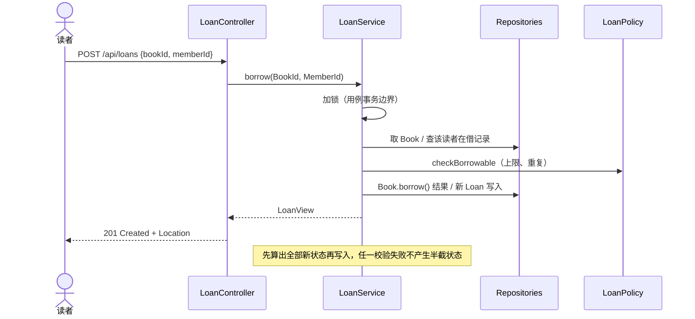

# 电子图书馆服务（E-Library Service）

后端技术作业实现。需求文档只给了五项功能、六个评价维度与「交付源码 + README」，**没有指定框架、分层方式或编码规范**。因此本项目的目标不是堆功能，而是用尽量小的范围把「架构、领域模型、API 设计、代码组织、错误处理、可维护性」讲清楚，并把**设计取舍**显式写下来。

> 文档注明「请控制实现范围在合理程度」「相较于功能是否完整，我们更重视你的思考过程以及设计取舍」。因此第 8 节（取舍）与第 6 节（领域模型）是全篇重点。

---

## 1. 需求对照

| 文档需求 | 实现 |
| --- | --- |
| 浏览书籍 | `GET /api/books`，支持关键词与分页 |
| 查询书籍详细资料 | `GET /api/books/{bookId}` |
| 借阅书籍 | `POST /api/loans` |
| 归还书籍 | `POST /api/loans/{loanId}/return` |
| 查看目前已借阅的书籍 | `GET /api/members/{memberId}/loans` |
| 展现架构 / 领域模型 / API / 代码组织 / 错误处理 / 可维护性 | 见第 5–9 节 |
| 交付源代码 + README | 本仓库 |

文档「概述」提到「阅读数字内容」，但需求清单未列出，故**不实现在线阅读**——属于有意识的范围控制（见第 8 节）。

---

## 2. 快速开始

环境：JDK 17 + Maven 3。本机 `mvn` 不在 `PATH`，使用 IntelliJ IDEA CE 自带的 Maven：

```bash
MVN="/Applications/IntelliJ IDEA CE.app/Contents/plugins/maven/lib/maven3/bin/mvn"
cd /Users/hbf/WorkBuddy/test_work/e-library-service

"$MVN" -o clean test          # 44 个测试，离线即可跑通
"$MVN" -o package             # 产出可运行 jar
java -jar target/elibrary-service-1.0.0-SNAPSHOT.jar --server.port=8080
```

`-o` 表示离线；本机 `~/.m2` 已缓存 Spring Boot 3.5.10 全套依赖。若你的环境已配置 `mvn`，直接用 `mvn test` / `mvn spring-boot:run`。

两个环境注意点：若运行环境注入了 `SERVER_PORT`，会覆盖配置里的 8080，所以上面显式传 `--server.port`；若设置了 `HTTP_PROXY`，本机 curl 请加 `--noproxy '*'`。**重新打包后需重启服务**，已运行的 JVM 仍加载旧类。

启动时自动注入 9 本示例书目（含电子书与期刊），第 2 本「设计模式」可借数为 0，便于直接验证 409。

---

## 3. API

| 方法 | 路径 | 请求 | 成功响应 |
| --- | --- | --- | --- |
| GET | `/api/books` | `keyword`（可选）、`page`（默认 1）、`size`（默认 10，上限 50） | 200 分页对象 |
| GET | `/api/books/{bookId}` | — | 200 `BookResponse` |
| POST | `/api/loans` | JSON `{ "bookId": 1, "memberId": "alice_01" }` | **201** `LoanResponse` + `Location` |
| POST | `/api/loans/{loanId}/return` | query `memberId` | 200 `LoanResponse` |
| GET | `/api/members/{memberId}/loans` | — | 200 `LoanResponse[]` |

`memberId` 规则：字母开头，仅含字母 / 数字 / 下划线，长度 4–32。规则只在 `MemberId` 值对象里定义，Web 注解直接引用它的常量。

```bash
curl --noproxy '*' 'http://localhost:8080/api/books?page=1&size=5'
curl --noproxy '*' -G 'http://localhost:8080/api/books' --data-urlencode 'keyword=重构'
curl --noproxy '*' 'http://localhost:8080/api/books/1'
curl --noproxy '*' -i -X POST 'http://localhost:8080/api/loans' \
  -H 'Content-Type: application/json' -d '{"bookId":1,"memberId":"alice_01"}'
curl --noproxy '*' 'http://localhost:8080/api/members/alice_01/loans'
curl --noproxy '*' -X POST 'http://localhost:8080/api/loans/1/return?memberId=alice_01'
```

成功响应不做统一包装，直接返回资源；分页响应形如：

```json
{
  "items": [{ "id": 1, "title": "深入理解计算机系统", "author": "Randal E. Bryant",
              "type": "EBOOK", "typeLabel": "电子书",
              "totalCopies": 3, "availableCopies": 3, "available": true }],
  "page": 1, "size": 10, "totalElements": 9, "totalPages": 1
}
```

---

## 4. 明确写下的假设

文档允许「对未明确说明的需求自行作出合理假设」，以下假设集中在此，便于评审时逐条挑战：

1. **一本书有多个可借副本**，用 `totalCopies / availableCopies` 表示，库存随借还增减。
2. **读者不做登录与鉴权**，用合法 `memberId` 声明身份；归还时必须显式传 `memberId`，服务校验记录归属。
3. **借期 14 天**，到期时间在签发时算好并随记录保存，之后改规则不影响历史记录；逾期只在响应里打 `overdue` 标记，不产生罚金。
4. **每人最多同时借 5 本**；**同一人不能重复借同一本尚未归还的书**。
5. **归还不是幂等的**：重复归还返回 409，把误操作暴露出来，而不是静默成功。
6. 数字内容分电子书与期刊两类（取自文档概述），只影响展示字段，不影响借还流程。
7. 页码从 **1** 开始，关键词对书名 / 作者做不区分大小写的包含匹配。
8. 数据存内存，**重启后借阅记录与库存变化丢失**，书目由 `DataSeeder` 重新注入。
9. 不做预约、续借、逾期罚金、在线阅读——需求清单未列出。

---

## 5. 应用架构与代码组织

四层、依赖单向。`domain` 是最内层，不依赖 Spring Web、不依赖任何具体存储；`infrastructure` 通过实现接口从外向内注入（依赖倒置）。

```mermaid
flowchart LR
    subgraph web["api — HTTP 适配"]
        C1[BookController]
        C2[LoanController]
        H[ApiExceptionHandler]
        D[dto record]
    end
    subgraph app["application — 用例编排"]
        S1[BookService]
        S2[LoanService]
        V[LoanView 读模型]
    end
    subgraph dom["domain — 聚合 / 值对象 / 领域服务"]
        A[Book · Loan 聚合根]
        P[LoanPolicy 领域服务]
        R[Repository 端口]
        E[ErrorCode · LibraryException]
    end
    subgraph infra["infrastructure — 实现"]
        R1[InMemory*Repository]
        SD[DataSeeder]
    end
    C1 --> S1
    C2 --> S2
    S1 --> R
    S2 --> A
    S2 --> P
    S2 --> R
    R1 -.实现.-> R
    SD --> R1
```



```
src/main/java/com/example/elibrary/
├── ElibraryApplication.java   启动类 + Clock / LoanPolicy Bean
├── domain/                    Book · Loan 聚合根；BookId/LoanId/MemberId 值对象
│                              LoanPolicy 领域服务；Repository 端口；Page；错误码
├── application/               BookService · LoanService（用例编排） · LoanView 读模型
├── infrastructure/            InMemoryBookRepository · InMemoryLoanRepository · DataSeeder
└── api/                       两个 Controller · ApiExceptionHandler · dto/
```

- **Controller** 只做参数校验、裸类型 ↔ 值对象、领域对象 → DTO 的转换；**Service** 只做编排；**domain** 持有全部业务规则；**infrastructure** 只管存取。
- 领域对象不直接对外序列化：`api/dto` 的 record 是独立对外契约，内部改造不影响 JSON。
- 分页与关键词过滤属于查询关注点，放在 `BookService`，仓储接口只保留聚合存取，不污染写模型契约。
- 全项目 **26 个主代码文件 / 约 900 行 + 5 个测试文件 / 约 525 行**。没有 Manager 层，也没有 DO / DTO / BO / VO 多套模型。

---

## 6. 领域模型设计

### 6.1 聚合边界与不变量

只拆出两个聚合，因为它们守护的是**不同、且生命周期不同**的不变量；读者没有自己的持久化状态，因此没有做成第三个聚合（理由见第 8 节第 9 条）。

| 领域对象 | 守护的不变量 / 职责 | 违反时 |
| --- | --- | --- |
| `Book`（聚合根） | `0 ≤ availableCopies ≤ totalCopies`，库存不足不得借出 | `BOOK_NOT_AVAILABLE` / `INVENTORY_INCONSISTENT` |
| `Loan`（聚合根） | 状态只能 `ACTIVE → RETURNED`；到期日由借期算好并固定 | `LOAN_ALREADY_RETURNED` |
| `LoanPolicy`（领域服务） | 借期 14 天、每人上限 5 本、同书未归还不可重复借 | `LOAN_LIMIT_EXCEEDED` / `DUPLICATE_LOAN` |

聚合之间**只用 ID 引用**（`Loan.bookId`、`Loan.memberId`），不持有对象引用。

### 6.2 值对象

| 值对象 | 收拢了什么 |
| --- | --- |
| `BookId` / `LoanId` | 正数标识，防止把 bookId 与 loanId 传错 |
| `MemberId` | 读者标识 + 唯一格式规则（Web 注解引用同一常量） |
| `Page<T>` | 分页结果，页码与总页数只在 `Page.of` 计算一次 |

`Book`、`Loan` 均为不可变 record，`borrow()` / `markReturned()` 返回新实例——并发推理只需关注「读 → 改 → 写」。

### 6.3 借书流程



跨聚合一致性由「一个用例事务 + 一把 `ReentrantLock`」保证：`LoanService` 先把新对象全部算出来，再依次 `save`；校验失败时一个字都不写。这是有意简化，不是领域事件 + 最终一致（见第 8 节第 6 条）。

---

## 7. 错误处理

领域层只抛一种 `LibraryException`，携带语义化 `ErrorCode`；**HTTP 状态映射集中在 `ApiExceptionHandler`**，所以 `domain` 包不 import 任何 Spring Web 类型。参数格式错误属于协议层，由值对象构造失败或 Bean Validation 触发，统一映射 400。错误体用 RFC 7807 `ProblemDetail`：

```json
{
  "type": "https://example.com/problems/elibrary",
  "title": "Conflict",
  "status": 409,
  "detail": "该书当前无可借副本",
  "code": "BOOK_NOT_AVAILABLE"
}
```

| code | HTTP | 触发场景 |
| --- | --- | --- |
| `INVALID_ARGUMENT` | 400 | 参数格式 / 范围非法、JSON 无法解析、值对象构造失败 |
| `BOOK_NOT_FOUND` / `LOAN_NOT_FOUND` | 404 | 书籍 / 借阅记录 id 不存在 |
| `RESOURCE_NOT_FOUND` | 404 | 接口路径不存在 |
| `LOAN_ACCESS_DENIED` | 403 | 归还他人记录 |
| `BOOK_NOT_AVAILABLE` | 409 | 无库存 |
| `DUPLICATE_LOAN` | 409 | 重复借同一本未归还的书 |
| `LOAN_LIMIT_EXCEEDED` | 409 | 在借达到 5 本上限 |
| `LOAN_ALREADY_RETURNED` | 409 | 重复归还 |
| `INVENTORY_INCONSISTENT` | 500 | 归还时副本数已等于总藏量（数据被破坏） |
| `INTERNAL_ERROR` | 500 | 未预期异常，记完整堆栈，不把细节返回客户端 |

分层约定：仓储与领域不吞异常；Service 记带业务参数的日志；Web 层统一兜底。业务 4xx 记 `warn`，5xx 记 `error` 并带异常对象。

---

## 8. 设计取舍（Trade-offs）

文档明确说更看重思考过程与取舍，因此每项决定都写清「放弃了什么、为什么、什么时候该改」：

| # | 选择 | 放弃了什么 | 理由 | 什么时候应该改 |
| --- | --- | --- | --- | --- |
| 1 | **内存仓储**，零外部依赖 | 持久化、重启不丢数据、多实例共享 | 作业预计 4–6 小时且要求控制范围；一条命令即可跑通，评审时不必先装数据库 | 需要真实数据时换 JPA + PostgreSQL，**只改 infrastructure** |
| 2 | **Repository 接口**（依赖倒置） | 多两个接口 | 领域层不依赖具体存储；单测可直接 new 内存实现，不启 Spring | 不需要改，这是低成本扩展点 |
| 3 | **不可变聚合根 + 值对象** | 简单数据类、直接改字段 | 不变量内聚在实体里，外部绕不过；并发推理更简单 | 换 ORM 时需按 JPA 托管实体的习惯调整 |
| 4 | **一个 `LibraryException` + 错误码枚举** | 编译期按异常类型区分错误 | 五个接口配九个异常类是过度设计；统一 catch + 集中映射更短 | 需要按错误类型做不同恢复策略时再拆 |
| 5 | **RFC 7807 `ProblemDetail` + 原生状态码** | 所有响应统一包一层 `Result<T>` | HTTP 状态码本身已表达成败；201 带 `Location`；ProblemDetail 是标准 | 团队已有强制统一响应规范时服从团队约定 |
| 6 | **单把 `ReentrantLock` 串行化借还** | 高并发吞吐 | 单实例内存场景下正确性优先；分段锁还要处理锁表清理与死锁顺序 | 多实例 / 高频借阅时改为数据库唯一约束 + 乐观锁 + 事务（锁必须去掉） |
| 7 | **不做登录鉴权**，用 `MemberId` + 归属校验 | 真实身份体系 | 文档未要求，控制范围；但仍保留「不能操作他人记录」这条边界 | 上生产必须接 Spring Security / JWT，从 token 取身份，**去掉请求里的 memberId** |
| 8 | **重复归还返回 409 而非幂等 200** | 客户端重试便利 | 显式暴露误操作，也让库存不会被重复回补 | 客户端需要安全重试时引入幂等键并返回首次结果 |
| 9 | **不做 `Member` 聚合**，读者规则归 `LoanPolicy` | 「每聚合一实体」的教科书式完整度 | 读者没有独立的持久化状态与生命周期；把上限/重复借阅放进一个无状态领域服务，比凭空造一个只为存集合的聚合更贴合「控制范围」 | 出现读者等级、信用、黑名单等独立状态与不变量时，再引入 `Member` 聚合 |
| 10 | **跨聚合一致性用用例事务，不用领域事件** | 聚合间解耦与独立扩展 | 单进程内存实现下用例事务已够；引入事件总线要处理最终一致、幂等、重试与补偿 | 拆成多服务 / 需要异步通知时改发领域事件 + Saga |
| 11 | **注入 `Clock`** | 少一个 Bean 的简单性 | 借期与逾期判定可重复测试，不依赖真实时间 | 不需要改 |
| 12 | **启动注入示例数据** | 真实书目导入流程 | 开箱即用；第 2 本特意设为无库存方便验证 409 | 生产环境改为迁移脚本 / 管理端录入 |
| 13 | **不实现在线阅读** | 文档概述提到的一个能力 | 需求清单未列出；宁可把五项需求做扎实，也不铺开半成品 | 需求明确后再设计内容分发与授权 |
| 14 | **没有 Manager 层、没有多套模型** | 「标准分层」的表面完整性 | 文档强调控制范围与可维护性；`LoanPolicy` 承载业务规则，不是组合 DAO 的编排层 | 用例显著增多、需要跨多个外部系统编排时再按复杂度引入 |

这里没有做完整 DDD（没有事件溯源、CQRS、聚合间最终一致），但每一处「没做」都是知道代价后的选择，而不是漏掉。

---

## 9. 测试

```
mvn -o clean test
→ Tests run: 44, Failures: 0, Errors: 0, Skipped: 0
```

| 测试类 | 用例 | 覆盖 |
| --- | --- | --- |
| `domain/BookTest` | 6 | 库存不变量、借出 / 归还、不可变性 |
| `domain/LoanTest` | 4 | 借期、状态单向流转、逾期判定 |
| `domain/LoanPolicyTest` | 4 | 在借上限、重复借阅、策略签发 |
| `application/LibraryServiceTest` | 15 | 借还主流程、库存回补、无半截状态、分页与关键词；固定 `Clock` |
| `api/LibraryApiTest` | 15 | MockMvc：200/201/400/403/404/409、ProblemDetail、`Location`、契约字段 |

领域层与应用层测试不启 Spring（自动 / 独立 / 可重复）；接口测试每个用例后重建容器以隔离内存状态。

---

## 10. 已知限制与演进路径

**已知限制**：重启丢数据；只能单实例；无鉴权；跨聚合一致性依赖进程内锁而非数据库事务；关键词是内存 `contains`，无索引；无预约 / 续借 / 逾期罚金；无 API 版本与 OpenAPI 描述。

**演进顺序建议**：

1. **持久化**：Spring Data JPA + PostgreSQL；给 `(member_id, book_id)` 在 `status = ACTIVE` 上加部分唯一索引作为借阅规则的兜底；`@Version` 乐观锁 + `@Transactional` 替代 `ReentrantLock`。只换 `infrastructure`。
2. **多实例**：去掉进程内锁，靠数据库约束保证正确性；书目读多写少可加缓存。
3. **身份**：Spring Security + JWT，从 token 取 `MemberId`，移除请求参数中的身份声明。
4. **领域深化**：需要读者等级 / 信用时引入 `Member` 聚合；跨服务时用领域事件替代用例事务。
5. **可运维**：springdoc-openapi、Actuator、结构化日志与指标；Testcontainers 做真实数据库集成测试。

---

## 11. 关于编码规范

需求文档**没有指定任何编码规范或技术栈**。本项目遵循 Java 与 Spring 社区的通用惯例（清晰命名、`record` 表达不可变值对象、SLF4J 占位符日志、`@Valid` 校验、常量集中、单一职责与单向依赖），**没有套用任何企业内部开发手册**。若评审方另有规范要求，按其约定调整命名与格式即可，架构与领域模型无需改动。
